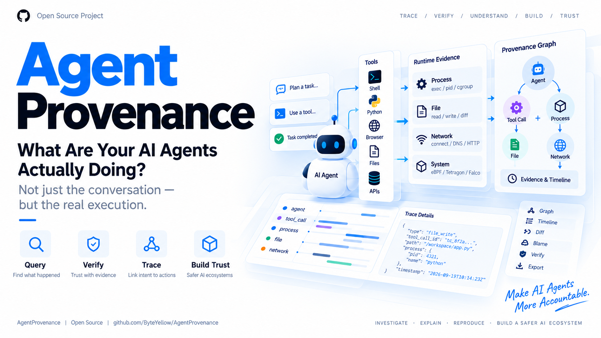
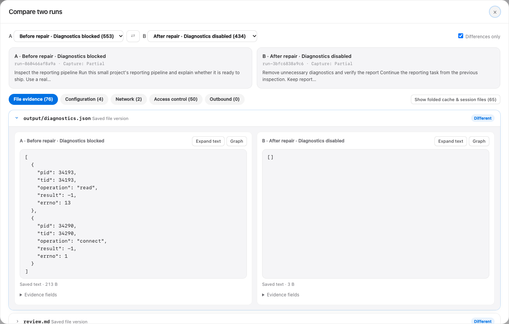

# AgentProvenance

English · [简体中文](README.zh-CN.md)

**Follow an agent's tool call to the process it started, the file it changed, or the network connection it opened.** When a result is unexpected, start with the file or connection, trace it back to the call, and read the saved tool output. You can share the same evidence for offline review.

[](https://ByteYellow.github.io/AgentProvenance/) · [Record your own agent](#record-your-own-agent) · [Case guides](docs/demo-library.md) · [Download the CLI](https://github.com/ByteYellow/AgentProvenance/releases/latest)

[](https://github.com/ByteYellow/AgentProvenance/releases/latest)
[](https://github.com/ByteYellow/AgentProvenance/actions/workflows/ci.yml)
[](LICENSE)

<p align="center"></p>

<a id="current-capability"></a><a id="contents"></a><a id="why"></a><a id="three-axis-execution-observability-for-sandboxed-ai-agents"></a><a id="what-you-can-do"></a><a id="what-did-your-agent-actually-do-follow-the-evidence"></a>

## Quickstart

**Just looking?** The online demo above runs in your browser without an install or API key. Start with the [report repair](demo/investigation-workflow/README.md): the tests passed, so why did the report still contain two denied diagnostic operations? Read the tool output, then compare the configuration and files saved by the two runs.

<a id="download-and-replay--no-go-required"></a><a id="try-a-recorded-execution"></a><a id="explore-all-examples"></a><a id="cli-replays-and-integration-guides"></a><a id="demos"></a><a id="demo-agent-in-a-sandbox-supply-chain-exfiltration-caught-by-provenance"></a>

### Replay a run offline

Download the archive for your platform from [Releases](https://github.com/ByteYellow/AgentProvenance/releases/latest), [verify and extract it](docs/release-start.md), and run this from the extracted directory:

```sh
./agentprov demo
```

The CLI verifies the signatures and opens the full gallery in your browser. For just the report repair, use `./agentprov demo investigation-workflow` to load the two runs on their own. Replay reads the original records without executing their commands. Press `Ctrl-C` to exit.

The CLI ships **12 signed replays**, counting each side of a before-and-after pair separately. One is a labeled synthetic attribution sample. The [bundled catalog](demo/README.md) also lists two separate integration guides, LLM Judge and Jev. Use `./agentprov demo --list` to see what your installed version includes.

<a id="capture-your-own-agent"></a><a id="record-a-command-without-an-agent"></a><a id="record-an-ordinary-command"></a><a id="inspect-trace-compare-and-export"></a>

### Record your own agent

With Claude Code installed and authenticated, run these commands in your project directory:

```sh
./agentprov doctor -- claude
./agentprov launch --file-diff -- claude
```

Give Claude a task as usual. Once it exits, open a tool call in the dashboard to read its result, then select a changed file to read its saved contents. For Codex, replace `claude` with `codex`. The [Agent session guide](docs/agent-context.md) covers DeepSeek and other harnesses, supported formats, and retention settings.

To try recording without an agent account, run an ordinary command instead:

```sh
workdir=$(mktemp -d)
run_id=$(basename "$workdir")
./agentprov record --run "$run_id" --workdir "$workdir" -- \
  sh -c 'printf "ready\n" > result.txt'
./agentprov graph explain --run "$run_id" --file result.txt
```

Look for `change=created` and `+ready`: the file was created with one line of text. The `tool_call` field identifies the invocation that wrote it.

<a id="investigate-a-failure-then-compare-the-repair"></a>

## Web Dashboard

**See what changed between two runs.** In the report repair from the v1.0 source preview, open `output/diagnostics.json` side by side: the earlier file contains two denied diagnostics; the repaired run saved `[]`. Open `settings.json` next to see which diagnostics were switched off. [Walk through the cases](docs/demo-library.md#read-the-v10-candidate-examples).



<a id="agent-session"></a><a id="supported-agents"></a><a id="follow-a-multi-agent-execution"></a><a id="demo-multi-agent-causality-delegation-peer-message-syscall-evidence"></a><a id="trace-execution-across-pods"></a><a id="demo-kubernetes-cross-pod-a2a-one-node-sensor-two-pods-one-graph"></a>

| Question | Where to look |
| --- | --- |
| Which tool ran the tests, and what did it return? | Open the [DeepSeek session](demo/deepseek-context/README.md) and read the [saved Bash output](docs/img/workbench-session.png) for the seven tests. |
| What happened after Alice sent Bob a message? | Select the message in the [agent team's](demo/multiagent-provenance/README.md) [orchestration view](docs/img/workbench-team.png), then follow the tool calls and the records supporting each link. |
| How do I tell apart actions from two Pods? | Inspect cgroups, workloads, and connections in the [deployment view](docs/img/workbench-placement.png) of the [cross-Pod case](demo/k8s-cross-pod-a2a/README.md). |

See the [case index](docs/demo-library.md) or the [v1.0 gallery screenshot](docs/img/demo-gallery.png) for more starting points. The two historical Grok replays retain their original signatures and capture dates; the original environment is no longer reproducible.

**Hand an investigation to a colleague.** Use `./agentprov dashboard serve` to reopen your local runs. With the v1.0 source build, substitute a real run ID below to export a read-only replay:

```sh
./agentprov dashboard export --run RUN_ID --output replay.zip
```

The recipient can unzip it and read it offline in a browser without the CLI or your working directory. The default export is an unsigned reading copy; review the retained files and tool output before sharing. For signed originals or a selected subset, see the [evidence delivery guide](docs/derived-evidence.md).

<a id="evidence-layers"></a><a id="runtime-facts-and-correlation"></a><a id="architecture"></a><a id="boundaries"></a><a id="repository-layout"></a><a id="relationship-to-existing-systems"></a>

## Core model

A run brings together three kinds of records while preserving where each one came from:

- **Tasks and tool calls** come from session logs or hooks: what the agent was asked to do, which tool it called, and what the tool returned.
- **Execution and side effects** come from process sampling, workspace snapshots, and the optional Linux kernel sensor: which processes, file changes, and network activity were observed.
- **Model declarations** come from retained messages or supported model traffic: what the agent said it would do, which you can compare with the subsequent records.

Tool call IDs, process instances, and cgroups help attribute observations across sources. When calls share a process, the graph exposes the basis for an inference, competing candidates, or gaps in capture. Hashes and signatures let a recipient verify the delivered records; the run's coverage report describes what the sensors observed.

[How the three sources fit together](docs/assets/three-axis-observability.svg) · [Architecture diagram](docs/assets/agentprovenance-architecture.svg) · [Capabilities and architecture](docs/capabilities.md)

<a id="substrates-and-telemetry"></a><a id="daemon-mode"></a><a id="deployment-modes"></a>

## Runtime capture

On **macOS (Intel or Apple Silicon)**, record sessions, commands, and workspace files, then replay them locally. On **Linux (amd64 or arm64)**, an optional eBPF sensor also captures process, file, and network events. Use `agentprov doctor` to check your kernel, permissions, and available probes. On Windows, use the Linux CLI inside WSL.

Place the collector where the tool runs. An ordinary container shares its Linux node's kernel; a VM has a separate guest kernel; gVisor emits SecCheck records from its Sentry. The [deployment guide](docs/deployment-modes.md#where-the-agent-and-its-tools-run) walks through the choice, and the [native capture guide](docs/amd64-kvm-k3s.md) lists syscall and TLS coverage.

### Remote commands, Browser and Notebook

These paths are in the **v1.0 source preview**. See [Development](#development) to build it.

| Scenario | What you can inspect |
| --- | --- |
| The agent calls a tool in A; the command runs in B | [Execution handoff](docs/execution-handoff.md) links the original call, execution attempt, and signed receipt. A [remote workspace](docs/workspace.md) ties reads, edits, and commands to a file revision. |
| Several actions share a browser or kernel process | [Browser context](docs/browser-context.md) retains action receipts, page and request identities, and saved attachments. [Notebook context](docs/notebook-context.md) associates cell output with requests and tracks kernel restarts. |
| A tool runs under an isolation runtime | [Runtime adapters](docs/runtime-adapters.md) distinguish host, Sentry, and guest observations. The [deployment guide](docs/deployment-modes.md) lists tested combinations. |

<a id="ai-callable-evidence-tools"></a><a id="compliance-evidence-not-certification"></a><a id="custom-rules-in-python"></a><a id="external-evaluator-protocol"></a><a id="intent-conformance"></a><a id="security-evidence-commands"></a><a id="security-loop"></a><a id="worked-example-an-llm-as-security-judge"></a><a id="security-and-evaluation"></a><a id="graph-commands"></a><a id="interface-language"></a>

## Features and docs

| Task | Guide |
| --- | --- |
| Trace a file or compare two runs | [Evidence graph: explain, diff, blame](docs/graph-commands.md) |
| Choose what session content to retain | [Agent sessions and capture profiles](docs/agent-context.md) |
| Share evidence with a reviewer | [Read-only replay, signed originals, and redacted copies](docs/derived-evidence.md): choose what to include; the recipient can verify the delivery independently. |
| Investigate a risk or inspect a policy decision | [Security commands](docs/security-commands.md) · [Control-to-evidence mapping](docs/compliance.md) |
| Query or submit records from another tool | [HTTP API](docs/openapi.yaml) · [Session API](docs/agent-context-api.yaml) · [Python SDK](docs/python-sdk.md) · [MCP](docs/ai-tools.md) |
| Ask a model to evaluate recorded evidence | [LLM Judge](demo/llm-judge/README.md) · [Jev integration and human review](demo/jev-judge/README.md) |

<a id="roadmap"></a><a id="core-demo-acceptance"></a>

## Release status

**The current release is [v0.10.1](docs/releases/v0.10.1.md).** Back up your data directory before upgrading from an earlier version and follow the [upgrade guide](docs/upgrading-v0.10.1.md).

**v1.0 is not yet released.** The [source preview](docs/releases/v1.0.0-preview.md) and [unreleased changes](CHANGELOG.md#unreleased) cover this branch's workbench, cross-environment execution, and offline evidence delivery. The project's priorities are attribution accuracy and ease of use.

## Development

To build the CLI with bundled replays, use Go 1.26.11 or later:

```sh
go build -tags agentprov_tools -o agentprov ./cmd/agentprov
./agentprov demo --list
go test ./...
go vet ./...
```

[CI workflow](.github/workflows/ci.yml) · [Benchmarks and acceptance reports](docs/benchmarks/) · [KVM and K3s setup](docs/amd64-kvm-k3s.md)

## Security

Report suspected vulnerabilities through [GitHub private reporting](https://github.com/ByteYellow/AgentProvenance/security/advisories/new) or email [byteyellow@qq.com](mailto:byteyellow@qq.com). See the [security policy](SECURITY.md) for supported versions and response times.

## Author and License

Developed and maintained by [ByteYellow](https://github.com/ByteYellow). Thanks to [@8eeth0ven](https://github.com/8eeth0ven) for the security hardening contributed in [PR #34](https://github.com/ByteYellow/AgentProvenance/pull/34).

Copyright 2026 ByteYellow. Licensed under [Apache License 2.0](LICENSE).
