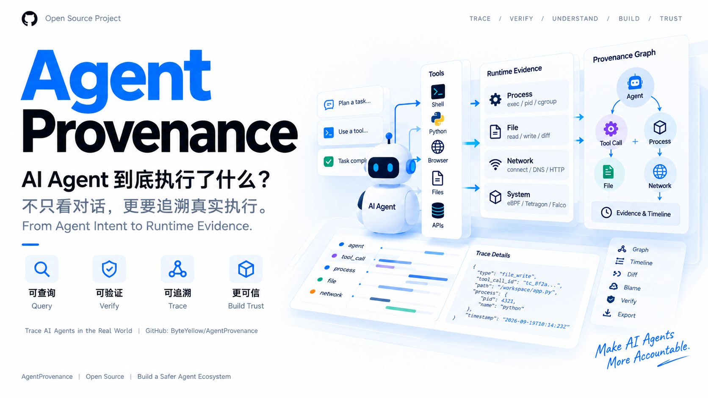
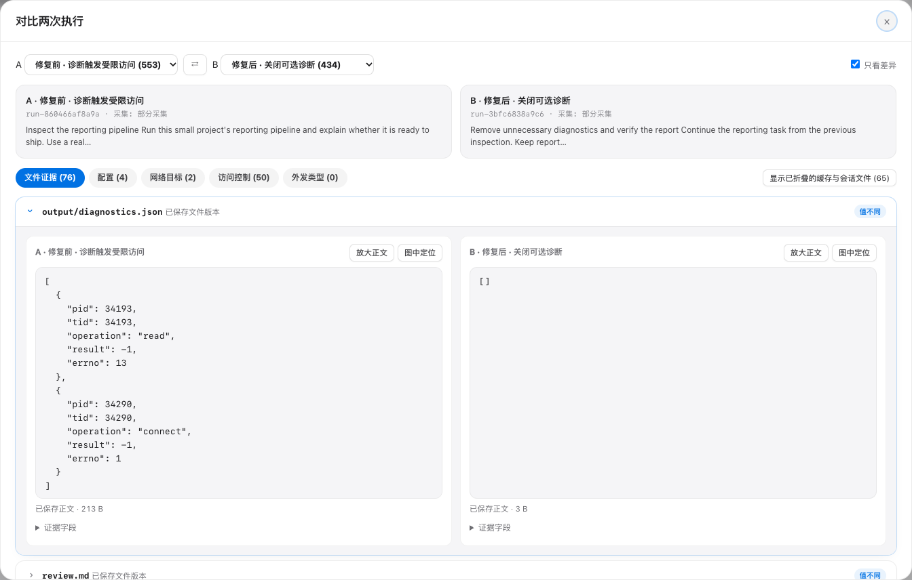

# AgentProvenance

[English](README.md) · 简体中文

**从 Agent 的一次工具调用，追到实际启动的进程、改动的文件和发出的网络连接。** 遇到意外结果时，你可以从文件或连接反查来源，打开当时保存的工具输出，再把这次执行交给别人离线复核。

[](https://ByteYellow.github.io/AgentProvenance/) · [记录自己的 Agent](#记录自己的-agent) · [查看案例](docs/zh-CN/demo-library.md) · [下载 CLI](https://github.com/ByteYellow/AgentProvenance/releases/latest)

[](https://github.com/ByteYellow/AgentProvenance/releases/latest)
[](https://github.com/ByteYellow/AgentProvenance/actions/workflows/ci.yml)
[](LICENSE)

<p align="center"></p>

<a id="当前能力"></a><a id="目录"></a><a id="为什么需要它"></a><a id="看清-ai-agent-的执行过程追溯每一步的来龙去脉"></a><a id="核心能力"></a><a id="agent-实际做了什么从任务到文件和网络一路追溯"></a>

## 快速开始

**只想看看它能查到什么？** 上方在线 Demo 无需安装或 API Key。可以先看[报表修复案例](demo/investigation-workflow/README.zh-CN.md)：测试通过了，为什么报表仍然记录了两次被拒绝的诊断操作？先读工具输出，再比较两次执行保存的配置和文件。

<a id="下载并回放无需安装-go"></a><a id="先回放一次真实执行"></a><a id="全部示例"></a><a id="cli-内置回放与集成指南"></a><a id="演示"></a><a id="demo追溯恶意依赖引发的文件读取与网络连接"></a>

### 在本机离线回放

从[发行页](https://github.com/ByteYellow/AgentProvenance/releases/latest)下载并[校验、解压](docs/zh-CN/release-start.md)与你的平台匹配的压缩包，在解压目录运行：

```sh
./agentprov demo
```

CLI 验证签名后，会在浏览器中打开完整示例库。只想看报表修复时，用 `./agentprov demo investigation-workflow` 单独加载修复前后的两次运行。回放读取当时的记录，不会重新执行命令。按 `Ctrl-C` 退出。

CLI 内置 **12 份签名回放**，修复前后各算一份，其中一份是明确标注的合成归因样本。[内置清单](demo/README.zh-CN.md)另列 LLM Judge 和 Jev 两篇集成指南。运行 `./agentprov demo --list` 可查看本机版本的清单。

<a id="记录你自己的-agent-执行"></a><a id="记录你自己的-agent"></a><a id="记录普通命令"></a><a id="查看行为追溯产物导出证据"></a>

### 记录自己的 Agent

以已安装并登录的 Claude Code 为例，在项目目录中运行：

```sh
./agentprov doctor -- claude
./agentprov launch --file-diff -- claude
```

像平常一样给 Claude 一个任务。退出后，在可视化界面里打开工具调用，查看返回值；再选中改过的文件，阅读保存的最终正文。Codex 使用同一入口，把 `claude` 换成 `codex` 即可。[会话指南](docs/zh-CN/agent-context.md)列出了 DeepSeek 等运行框架的接入方式、格式和留存选项。

也可以先记录一条普通命令，不需要 Agent 账号：

```sh
workdir=$(mktemp -d)
run_id=$(basename "$workdir")
./agentprov record --run "$run_id" --workdir "$workdir" -- \
  sh -c 'printf "ready\n" > result.txt'
./agentprov graph explain --run "$run_id" --file result.txt
```

输出中的 `change=created` 和 `+ready` 分别对应文件的创建和新增的一行正文，`tool_call` 指向这次命令调用。

<a id="web-dashboard"></a><a id="调查失败再比较修复结果"></a>

## 可视化界面

**从两份文件看懂一次修复。** 下图来自 v1.0 源码预览的报表案例。展开 `output/diagnostics.json`：修复前有两条被拒绝的诊断记录，修复后保存的正文是 `[]`。再打开 `settings.json`，就能核对这次任务关闭了哪些诊断项。[案例阅读指南](docs/zh-CN/demo-library.md#v10-候选示例看什么)



<a id="agent-会话"></a><a id="支持的-agent"></a><a id="追踪一次多-agent-协作"></a><a id="demo关联多-agent-的任务委派协作消息与系统调用"></a><a id="追踪跨-pod-执行"></a><a id="demokubernetes-跨-pod-调用与事件归属"></a>

| 你想查什么？ | 从哪里入手 |
| --- | --- |
| 哪次调用跑了测试，结果是什么？ | 在 [DeepSeek 会话](demo/deepseek-context/README.zh-CN.md)里打开 Bash 的[工具输出](docs/img/workbench-session-zh-CN.png)，读当时保存的七项测试结果。 |
| Alice 发给 Bob 的消息之后发生了什么？ | 从[多 Agent 协作](demo/multiagent-provenance/README.zh-CN.md)的[协作图](docs/img/workbench-team-zh-CN.png)选中消息，查看后续工具调用和支持关联的记录。 |
| 两个 Pod 的操作怎样区分？ | 在[跨 Pod 案例](demo/k8s-cross-pod-a2a/README.zh-CN.md)的[部署视图](docs/img/workbench-placement-zh-CN.png)中核对 cgroup、工作负载和连接。 |

更多入口见[案例索引](docs/zh-CN/demo-library.md)和 [v1.0 示例库截图](docs/img/demo-gallery-zh-CN.png)。其中两份 Grok 历史回放保留了原始签名与采集日期，原场景现已无法重跑。

**把调查交给同事。** 用 `./agentprov dashboard serve` 重新打开本机的记录。在 v1.0 源码版中，可将下面的 `RUN_ID` 换成实际运行 ID，导出只读回放：

```sh
./agentprov dashboard export --run RUN_ID --output replay.zip
```

对方解压后即可在浏览器中离线阅读，无需 CLI 或原工作目录。默认导出的是未签名阅读副本；分享前请检查留存的文件与工具输出。需要核验原始签名或只交付选定内容时，见[证据交付指南](docs/zh-CN/derived-evidence.md)。

<a id="证据分层"></a><a id="运行时事实与关联"></a><a id="架构"></a><a id="与现有系统的关系"></a><a id="仓库结构"></a><a id="边界"></a>

## 核心模型

一次运行（Run）把三类记录放在一起，但保留各自的来源：

- **任务与工具调用**来自会话或 Hooks，说明 Agent 收到了什么请求、调用了什么工具、工具返回了什么。
- **执行与副作用**来自进程采样、工作区快照和可选的 Linux 内核传感器，说明实际观察到了哪些文件变化、进程或网络活动。
- **模型声明**来自已留存的消息或受支持的模型通信，可用于对照 Agent 声明要做的事与后续记录。

工具调用 ID、进程实例和 cgroup 等身份用于关联不同来源的记录。多个调用共用进程时，证据图会标明推断依据、候选或采集缺口。内容哈希和签名用来核验交付的记录；传感器当时观察到了哪些操作，要看该次运行的采集报告。

[三类证据如何关联](docs/assets/three-axis-observability-zh-CN.svg) · [系统架构图](docs/assets/agentprovenance-architecture-zh-CN.svg) · [功能与架构参考](docs/zh-CN/capabilities.md)

<a id="基质与遥测"></a><a id="运行环境与遥测"></a><a id="部署模式"></a><a id="本地服务daemon模式"></a><a id="部署方式"></a>

## 运行时采集

在 **macOS（Intel 或 Apple Silicon）** 上，可以记录会话、命令和工作区文件并回放。在 **Linux（amd64 或 arm64）** 上，还可以启用 eBPF 传感器，采集进程、文件和网络事件。先用 `agentprov doctor` 检查内核、权限与可用探针。Windows 用户可在 WSL 中使用 Linux CLI。

采集放在哪一层，取决于工具实际在哪里执行：普通容器可从 Linux 节点采集；有独立内核的虚拟机要在 guest 内观察；gVisor 的 SecCheck 记录来自 Sentry。[部署指南](docs/zh-CN/deployment-modes.md#先看-agent-和工具在哪里运行)解释如何选择，[原生采集指南](docs/zh-CN/amd64-kvm-k3s.md)列出系统调用与 TLS 探针的覆盖范围。

### 远端命令、浏览器与 Notebook

以下入口属于 **v1.0 源码预览**。按[开发说明](#开发)构建即可试用。

| 场景 | 能查到什么 |
| --- | --- |
| Agent 在 A 发起调用，命令在 B 执行 | [跨沙箱执行](docs/zh-CN/execution-handoff.md)保留原始调用、执行尝试和签名回执；[远端工作区](docs/zh-CN/workspace.md)把读、改、跑对应到同一文件版本。 |
| 多次操作复用一个浏览器或内核进程 | [浏览器](docs/browser-context.zh-CN.md)记录操作回执、页面、请求和已保存的附件；[Notebook](docs/zh-CN/notebook-context.md)按请求关联单元格输出与内核重启。 |
| 在隔离运行时采集 | [运行时适配](docs/zh-CN/runtime-adapters.md)区分宿主、Sentry 和 guest；[部署指南](docs/zh-CN/deployment-modes.md)列出已验收的组合。 |

<a id="ai-可调用的证据工具"></a><a id="合规映射"></a><a id="合规证据而非合规认证"></a><a id="外部评估器协议"></a><a id="安全证据命令"></a><a id="安全闭环"></a><a id="实例让-llm-分析安全证据"></a><a id="意图一致性"></a><a id="用-python-写自定义规则"></a><a id="安全分析与外部评估"></a><a id="graph-命令"></a><a id="证据图命令"></a>

## 功能与文档

| 我要做什么 | 指南 |
| --- | --- |
| 追溯某个文件或比较两次运行 | [证据图命令：explain、diff、blame](docs/zh-CN/graph-commands.md) |
| 选择保存哪些会话内容 | [会话与留存档位](docs/zh-CN/agent-context.md) |
| 把证据交给其他人 | [只读回放、签名原件与脱敏副本](docs/zh-CN/derived-evidence.md)：交付前选择范围，接收方可独立验证。 |
| 调查异常或核对策略决定 | [安全命令](docs/zh-CN/security-commands.md) · [控制项与证据映射](docs/zh-CN/compliance.md) |
| 从自己的工具读写记录 | [HTTP API](docs/zh-CN/openapi.yaml) · [会话 API](docs/agent-context-api.yaml) · [Python SDK](docs/zh-CN/python-sdk.md) · [MCP](docs/zh-CN/ai-tools.md) |
| 用模型评审执行证据 | [LLM Judge](demo/llm-judge/README.zh-CN.md) · [Jev 接入与人工复核](demo/jev-judge/README.zh-CN.md) |

<a id="roadmap"></a><a id="核心-demo-验收"></a><a id="版本进展与后续计划"></a>

## 版本进展

**当前发行版是 [v0.10.1](docs/zh-CN/releases/v0.10.1.md)。** 从旧版本升级请先备份数据目录，参阅[升级指南](docs/zh-CN/upgrading-v0.10.1.md)。

**v1.0 尚未发布。** 本分支的工作台、跨环境执行和离线证据交付见 [v1.0 源码预览](docs/zh-CN/releases/v1.0.0-preview.md)与[未发布变更](CHANGELOG.zh-CN.md#未发布)。后续优先提升归因准确性与使用体验。

## 开发

从源码构建含内置示例的 CLI 需要 Go 1.26.11 或更高版本：

```sh
go build -tags agentprov_tools -o agentprov ./cmd/agentprov
./agentprov demo --list
go test ./...
go vet ./...
```

[持续集成](.github/workflows/ci.yml) · [性能与验收报告](docs/benchmarks/) · [KVM 与 K3s 实机环境](docs/zh-CN/amd64-kvm-k3s.md)

## 安全报告

请通过 [GitHub 私密漏洞报告](https://github.com/ByteYellow/AgentProvenance/security/advisories/new) 或 [byteyellow@qq.com](mailto:byteyellow@qq.com) 联系维护者。支持版本和响应流程见[安全政策](docs/zh-CN/security.md)。

## 作者与许可

[ByteYellow](https://github.com/ByteYellow) 开发并维护本项目。感谢 [@8eeth0ven](https://github.com/8eeth0ven) 在 [PR #34](https://github.com/ByteYellow/AgentProvenance/pull/34) 中贡献安全加固改进。

Copyright 2026 ByteYellow。采用 [Apache License 2.0](LICENSE)。
