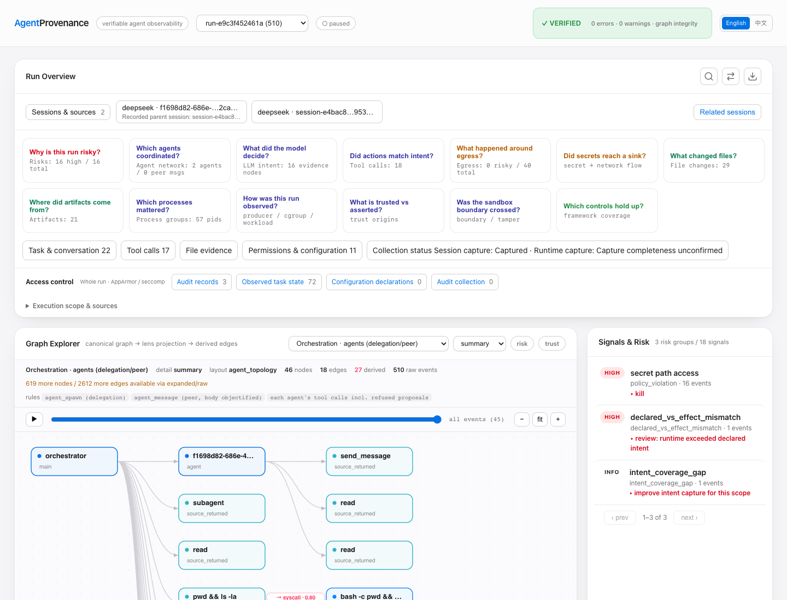

# Investigate, Repair, Compare

English | [中文](README.zh-CN.md)

One reporting task, two recorded executions. DeepSeek delegates a source review,
runs seven tests, and encounters denied diagnostics. It then resumes the same
session, disables the unnecessary diagnostics, and produces the report successfully.

The example connects native parent/child sessions, tool results, Linux process
and file evidence, AppArmor/seccomp decisions, saved files, search, comparison,
and a portable read-only replay in the existing Dashboard.



## Open the Demo

From a source build containing this example:

```sh
go build -o agentprov ./cmd/agentprov
./agentprov demo investigation-workflow
```

This loads both signed captures into a temporary local store. Replay needs no
API key or virtual machine. The original evidence is verified before import.

## The Investigation

| Stage | What happened | Where to look |
| --- | --- | --- |
| Inspect | The main session asks a real subagent to review `pipeline.py` and `settings.json`. | **Related sessions**, then **Conversation & tools** |
| Test | The seven summarization tests pass. The reporting command still fails because optional diagnostics are enabled. | Search for `permission denied` or `Ran 7 tests` |
| Explain | AppArmor denies a read of the public canary; seccomp logs that operation and rejects a separate loopback connection. | **Access control** and its attempt / decision / result reader |
| Repair | The original session continues and changes two configuration values to `false`. The security mechanisms stay in place. | Switch to the repaired Run, then read the edit and tool output |
| Compare | The report total stays `42.00`; diagnostic results change from two errors to an empty list. | **Compare**: configuration, files, network and access control |
| Share | Choose the records and saved bodies to include, preview them, then export a read-only page. | **Export replay** |

The Run selector contains the inspection and repaired executions. The replay
guide and capture manifest identify their original Run IDs. **Related sessions**
shows both delegation within a Run and continuation across the two Runs.

### Read a Decision

The inspection Run includes three kernel audit records:

- seccomp `LOG` for `openat`: the filter permits the call to continue while logging it.
- AppArmor `DENIED` for the canary read: the program reports `EACCES` (`13`).
- seccomp `ERRNO` for `connect`: the program reports `EPERM` (`1`).

The audit records associate with process lifetimes. In this capture, the millisecond
windows do not uniquely pair the audits with individual syscalls; operation details
show that gap. Read the program's errno values separately in tool output and
`output/diagnostics.json`. The fixture deliberately activates these policies; the
AgentProvenance importer reads their records without installing or changing them.

### Compare the Two Runs

Choose the inspection Run as A and the repaired Run as B. In **File evidence**,
inspect `settings.json`, `output/diagnostics.json`, `output/report.json`, and
`review.md`. Read the saved bodies for the exact changes.

**Configuration** contains Harness configuration history; application settings
such as `settings.json` appear with the captured files. **Access control** compares
recorded decisions and observed states. The UI labels one-sided records explicitly.

### Export a Focused Replay

Use **Export replay**, select the task, relevant calls and report files, and inspect
the content preview before downloading. Open the exported `index.html` locally.
The selected replay is a new, unsigned view; the bundled source captures retain
their original signatures. Evidence text is displayed, never executed.

## Recorded Evidence

[capture-manifest.json](capture-manifest.json) lists the capture date, Run IDs,
native sessions, audit counts, compressed bundle sizes and checksums.

This is a controlled real execution on Linux ARM64, using DeepSeek Harness
`0.1.7-rc.2`. The fixture contains only sample orders and a public fake canary.
Its rate service and denied diagnostic destination use loopback. The model
requests use the configured DeepSeek service.

Capture status remains visible in each Run. Native session lineage is retained
from the Harness; tool-to-process links carry their own association basis.
The displayed test output belongs to these recorded executions.
The resumed run also retains earlier context; the reader labels prior context,
and its message and tool totals include those saved records.

## Recapture

Use a disposable Linux VM with a working native sensor, cgroup support, AppArmor,
seccomp audit logging, Python 3, a static C toolchain, and a configured DeepSeek
Harness. Keep funded credentials outside the fixture directory. The environment
file must set `DEEPSEEK_API_KEY` or `ANTHROPIC_AUTH_TOKEN`.

```sh
sudo python3 demo/investigation-workflow/capture.py \
  --binary /absolute/path/to/agentprov \
  --output /absolute/path/to/new-capture \
  --user agentprov \
  --dsh-home /home/agentprov/path/to/dsh-home \
  --env-file /home/agentprov/path/to/model.env \
  --tls-library /absolute/path/to/harness-node-or-libssl \
  --libc-library /lib/aarch64-linux-gnu/libc.so.6
```

The runner attaches a temporary AppArmor profile only to its own `guard-probe`
executable, and removes that profile on exit. The helper installs its own
seccomp filter. A preflight checks actual denials and audit delivery before
starting the model. Two fresh native captures follow; no historical events are
inserted into them.

Review `public/` before sharing. It contains signed compressed bundles, their
public key and a manifest. The `private/` directory holds the store, logs and
signing private key and must stay private. Keep this supplied historical capture
intact when recording another run.
