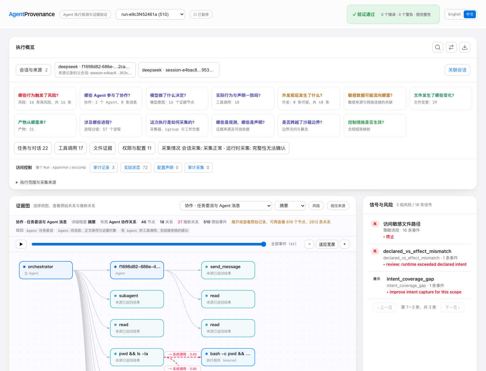
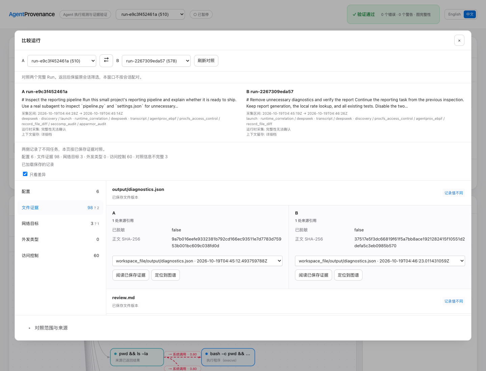

# 从调查到修复，再比较两次执行

[English](README.md) | 中文

同一个报表任务，两次真实执行。DeepSeek 先委派子 Agent 审查代码，运行七项测试，
发现额外诊断触发了访问拒绝；随后继续原会话，关闭不必要的诊断，成功生成报表。

这个示例把父子会话、工具结果、Linux 进程与文件记录、AppArmor/seccomp 决策、
已保存文件、搜索、前后对比和只读导出串在现有 Dashboard 中。



## 打开示例

使用包含本示例的源码构建：

```sh
go build -o agentprov ./cmd/agentprov
./agentprov demo investigation-workflow
```

命令会校验原始签名，并将两份记录加载到临时本地数据目录。
回放不需要 API Key 或虚拟机。

## 调查路线

| 阶段 | 发生了什么 | 去哪里看 |
| --- | --- | --- |
| 检查 | 主会话让真实子 Agent 审查 `pipeline.py` 和 `settings.json`。 | **关联会话**，再打开**对话与工具** |
| 测试 | 七项计算测试通过，但报表命令因可选诊断被拒绝而失败。 | 搜索 `permission denied` 或 `Ran 7 tests` |
| 解释 | AppArmor 拒绝读取公开测试凭据；seccomp 记录该调用，并拒绝另一次本地连接。 | **访问控制**及操作尝试、机制决策、实际结果详情 |
| 修复 | 原会话继续执行，把两个配置值改为 `false`，安全策略保持原样。 | 切换到修复后的 Run，阅读修改和工具结果 |
| 对比 | 报表总额仍为 `42.00`，诊断结果从两条错误变为空列表。 | **对比**中的配置、文件、网络和访问控制 |
| 分享 | 选择要保留的记录与正文，预览后导出独立只读页面。 | **导出回放** |

Run 选择框包含检查与修复两次执行，采集清单保留各自的原始 Run ID。
**关联会话**既展示本次执行中的委派关系，也展示原会话跨两次 Run 的继续执行。

### 阅读一次访问控制决策

检查阶段包含三条内核审计记录：

- seccomp 对 `openat` 记为 `LOG`，调用继续向下执行。
- AppArmor 对测试凭据读取记为 `DENIED`，程序报告 `EACCES`（`13`）。
- seccomp 对 `connect` 记为 `ERRNO`，程序报告 `EPERM`（`1`）。

审计已关联到进程生命周期；这份记录中，毫秒级时间窗口未把审计与具体 syscall 唯一配对，
操作详情保留此缺口。程序的 `errno` 返回值可从工具输出及 `output/diagnostics.json` 单独阅读。
临时策略由演示环境预先配置；
AgentProvenance 只读取和关联这些记录。

### 比较两次执行

将 A 设为**诊断修复 · 修复前**，将 B 设为**诊断修复 · 修复后**。
两次执行的原始 ID 分别为 `run-e9c3f452461a` 和 `run-2267309eda57`。
在**文件证据**中查看 `settings.json`、
`output/diagnostics.json`、`output/report.json` 和 `review.md`，打开保存正文阅读变化。

**配置**维度展示 Harness 的配置历史，`settings.json` 这样的业务配置文件放在
文件证据中。**访问控制**维度比较已记录的决策和状态，单侧记录按原有采集范围显示。



### 导出精简回放

打开**导出回放**，选中任务、相关调用和报表文件，在内容预览中检查范围后下载。
解压后直接打开 `index.html`。这是新生成的未签名阅读视图；来源 Bundle 的原始签名
仍可单独校验。证据中的文字与命令只作展示。

## 采集记录

[采集清单](capture-manifest.json)列出采集日期、Run ID、原生会话、审计数量、
压缩包体积和校验值。

示例在 Linux ARM64 上使用 DeepSeek Harness `0.1.7-rc.2` 实际运行。
工作目录只有样例订单与公开的假凭据；汇率服务和被拒绝的诊断连接均使用本机回环地址，
模型请求使用已配置的 DeepSeek 服务。

每次 Run 的采集状态继续保留在界面中。父子会话关系来自 Harness 原始记录，
工具与进程关联显示各自的关联依据。页面中的测试结果属于这两次已记录执行。
修复轮还保留续跑所需的先前会话内容；界面标记历史上下文，消息与工具数量包含这部分记录。

## 重新采集

准备一次性 Linux 虚拟机，以及可用的原生 Sensor、cgroup、AppArmor、seccomp 审计、
Python 3、静态 C 编译环境和已配置的 DeepSeek Harness。将有余额的凭据保存在
工作目录之外；环境文件需提供 `DEEPSEEK_API_KEY` 或 `ANTHROPIC_AUTH_TOKEN`。

```sh
sudo python3 demo/investigation-workflow/capture.py \
  --binary /absolute/path/to/agentprov \
  --output /absolute/path/to/new-capture \
  --user agentprov \
  --dsh-home /home/agentprov/path/to/dsh-home \
  --env-file /home/agentprov/path/to/model.env \
  --tls-library /absolute/path/to/harness-node-or-libssl \
  --libc-library /lib/aarch64-linux-gnu/libc.so.6
```

脚本只给自己生成的 `guard-probe` 程序加载临时 AppArmor profile，并在退出时卸载。
辅助程序只为自身安装 seccomp filter。启动模型前，预检会核实实际拒绝结果和审计记录，
随后采集两次新的执行。

分享前检查 `public/` 中的签名压缩包、公钥和清单。`private/` 保存本地数据、日志和
签名私钥，请勿公开。新的采集结果另存，不覆盖仓库中的历史样本。
